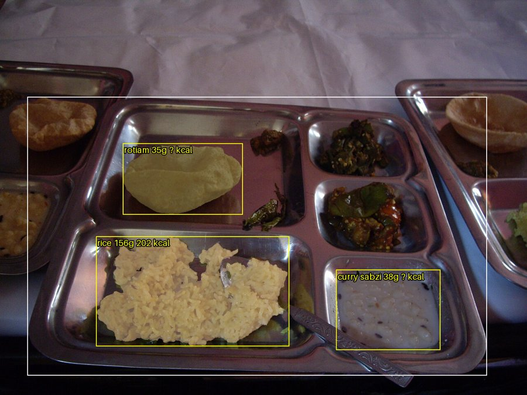
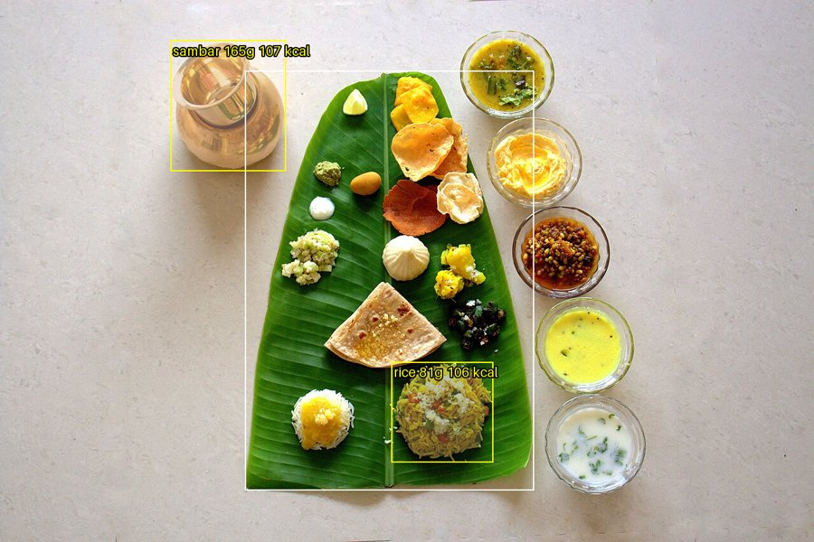
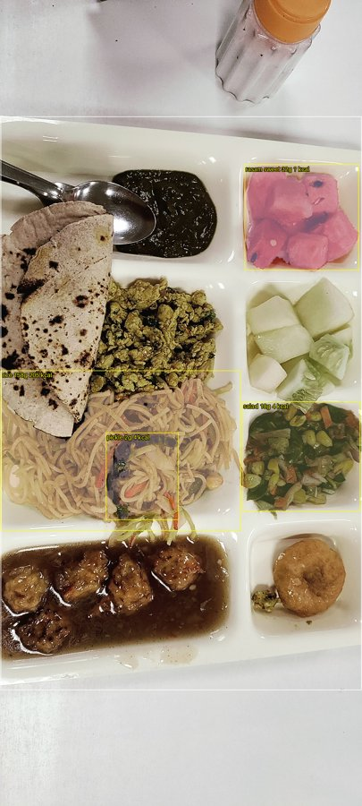

# Thali Dish, Weight & Nutrition Estimation Pipeline

```
image ─► GroundedSAM2 ─► food segments ─► encoder + kNN prototypes ─► dish label
             │                  │                                         │
             └── plate box ─────┴──────────► weight estimator ◄───────────┘
                                                    │ grams
                                                    ▼
                                             calorie lookup ─► kcal / protein / carbs / fat
```

| Stage | File | Status |
|---|---|---|
| 1. Segmentation (GroundingDINO boxes → SAM2 masks) | `thali/segmentation.py` | Pretrained, works now |
| 2. Matching (DINOv2 embeddings → kNN over prototypes) | `thali/matching.py` | Pretrained encoder; needs a few labelled crops per dish |
| 2b. Colour/texture-aware ViT | `thali/ct_vit.py` | Architecture only — train when the dataset is ready, then swap in for `FeatureEncoder` |
| 3. Weight estimation | `thali/estimation.py` | **Placeholder**: area × depth × density, plate used as scale. Replace with the learned network |
| 4. Calorie lookup | `data/dish_table.csv` | **Approximate values** — verify against IFCT 2017 and the mess recipes |

Until `data/prototypes.npz` exists, dish names come from GroundingDINO's matched prompt word.

## Setup (Windows, RTX 3050 6 GB)

Keep the virtual environment **outside OneDrive** so it isn't synced:

```powershell
python -m venv C:\venvs\thali
C:\venvs\thali\Scripts\activate
pip install torch torchvision --index-url https://download.pytorch.org/whl/cu126
pip install -r requirements.txt
python -c "import torch; print(torch.cuda.is_available())"   # should print True
```

`sam2` installs from GitHub (needs `git`). If its optional CUDA extension fails to build on Windows,
that's fine — it only affects mask post-processing; set `$env:SAM2_BUILD_CUDA=0` before installing to skip it.
First run downloads model weights (~1 GB) from Hugging Face.

## Usage

```powershell
# 1. Put a few thali photos in data/samples/ and run the pipeline
python run_pipeline.py --image data/samples --save-crops

# 2. Sort outputs/crops/*.png into data/prototypes/<dish>/ (folder names = dish names in dish_table.csv)
python build_prototypes.py

# 3. Run again - labels now come from kNN matching
python run_pipeline.py --image data/samples

# Check the colour/texture ViT and its training memory on your GPU
python check_ct_vit.py --pretrained --batch 16
```

Outputs per image in `outputs/`: `<name>_result.png` (masks + labels + grams + kcal) and `<name>_result.json`.

## First results (baseline, 26 Oct 2026)

We ran the full pipeline once on 12 sample thali photos from Wikimedia Commons, using the default settings.
The goal was to check that every stage connects end to end, not to measure accuracy.

**Setup for this run:** no dish prototypes yet, so dish names come straight from the detector's text prompt;
weights come from the simple placeholder formula (area × depth × density).

### Summary

✅ **The pipeline works end to end.** Image in, masks + dish labels + grams + calories out.
❌ **It misses most dishes.** Only **0–4 dishes found per thali**, while most plates have 6–10.
❌ **Many labels are wrong.** Noodles were called "rice", watermelon "rasam sweet", a water pot "sambar".

| Image | Dishes on plate | Found | What it said |
|---|---|---|---|
| thali_02 (steel thali) | 7 | **0** | nothing detected |
| thali_03 (steel tray) | 6 | 3 | rice ✓, papad → "rotiam" ✗, curd → "curry sabzi" ✗ |
| thali_05 (banana leaf) | 15+ | 2 | water pot → "sambar" ✗, pulao → "rice" ~ |
| thali_09 (compartment plate) | 8 | 4 | noodles → "rice" ✗, watermelon → "rasam sweet" ✗, salad ✓ |

<p>
  
  
</p>


*Yellow boxes = detected dishes with estimated grams and kcal. White box = detected plate.*

### Why is it missing dishes?

The first step, **GroundingDINO**, finds objects by matching image regions to the words in a text prompt.
We gave it a list of dish names (`roti . rice . dal . curry . sabzi ...`). To find the cause, we re-ran it
on two images with the confidence cut-off lowered to 0.10 to see everything it considers:

| Prompt given to GroundingDINO | thali_02: boxes with confidence ≥ 0.30 | thali_09 |
|---|---|---|
| Dish names (current) | **0** (highest score only 0.26) | 4 |
| `food .` | **8** | 4 |
| `bowl . food .` | **10** | 4 |

The plate itself was found with high confidence (0.79), so the plate was not the problem.

**1. The detector doesn't know Indian dish names.**
GroundingDINO learned from mostly Western image datasets. Words like *dal*, *sabzi* or *sambar* were rarely
in its training data, so it can't confidently link them to a picture. It does *see* the dishes (it proposed
27 candidate boxes on thali_02), but it isn't sure which word fits, so every score stays low.

**2. Its confidence is split across all 12 words.**
Because it can't pick one name, it spreads its confidence over many, which shows up in the labels it
produced: `"roti dal curry sab rasam papad sweet"`. That's also where broken labels like `"rotiam"` and `"##am"`
come from: they are word pieces glued together.

**3. The 0.30 confidence cut-off removes the rest.**
With scores stuck around 0.20–0.26, nothing passes the `box_threshold: 0.30` filter on thali_02.

**4. The model is the smallest version.** We use `grounding-dino-tiny` to fit a 6 GB laptop GPU.
Larger versions detect more reliably.

**In short:** we were asking the detector to both *find* the dishes and *name* them. It's decent at the
first and poor at the second, especially for Indian food. In the project design, naming is the job of the
**Matching stage** (encoder + kNN prototypes), not the detector.

### Why are the weights not meaningful yet?

They come from a placeholder formula (dish area × typical depth × density), not a trained model. Real
weight estimation needs the weighed-portion dataset that's still being collected.

### Alternatives and fixes

| Option | What it means | Expected effect | Effort |
|---|---|---|---|
| **1. Generic prompt** (recommended first) | Ask the detector only for `food . bowl of food .`; let kNN name the dish | Many more dishes found, no broken labels | Very low (config change) |
| **2. Lower the cut-off** | `box_threshold` 0.30 → ~0.25 | More dishes found, but some false boxes | Very low |
| **3. Keep only boxes inside the plate** | Ignore detections outside the plate area | Removes water pots, glasses, side plates | Low |
| **4. Build kNN prototypes** | Label a few cropped examples per dish | Correct dish names, including dishes not in the prompt | Medium (labelling) |
| **5. Bigger detector** | `grounding-dino-base` instead of tiny | Better recall; slower, more GPU memory | Low (may need Colab) |
| **6. Skip the detector: SAM2 "segment everything"** | SAM2 splits the whole plate into regions; kNN keeps the food ones | Finds almost every dish; more false regions to filter | Medium |
| **7. Fine-tune a detector on our own data** | Train on labelled mess thali photos (e.g. YOLO-seg or GroundingDINO fine-tune) | Best accuracy long term | High (needs dataset) |

**Plan:** try options 1–3 first (quick config changes), then 4 once a few crops are labelled.
Option 7 becomes possible once the dataset is ready.

Sample images: [thali_03](https://commons.wikimedia.org/wiki/File:Aloo_Palak,_Baigan,_Raita_%26_Chapatti_(5105346232).jpg),
[thali_05](https://commons.wikimedia.org/wiki/File:Chitpavan_Brahmin_Thali.jpg),
[thali_09](https://commons.wikimedia.org/wiki/File:Full_Meal_(Thali).jpg) from Wikimedia Commons; see each
page for author and licence. Result images are annotated derivatives.

## Tuning

All settings are in `config.yaml`: the GroundingDINO prompt (add your mess's dish names), detection
thresholds, the real plate diameter (measure it — it sets the pixel→cm scale), and the kNN `k` /
`min_similarity`.

## When the dataset arrives

1. Train `ColourTextureViT` on labelled crops (classification + embedding loss); wrap it with the
   `FeatureEncoder` interface (list of PIL crops → normalised embeddings).
2. Train a weight network with the `GeometricWeightEstimator.__call__` signature
   `(image, segment, label, plate_box) -> grams`, using the weighed-portion labels.
3. Evaluate: mask IoU (segmentation), top-1 accuracy (dish), MAE in grams and kcal (weight / calories).
